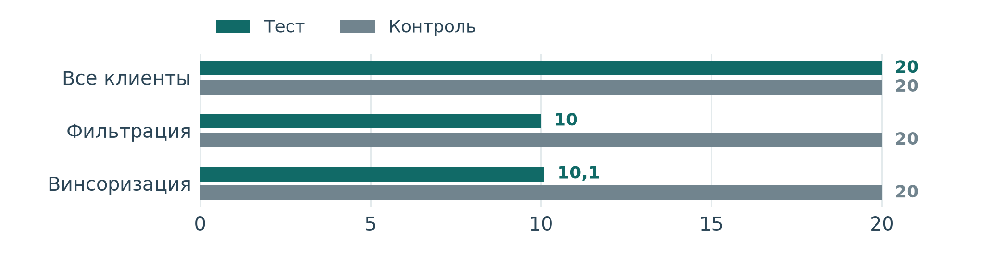

# Обработка аномалий при пост-анализе пилотов

## Цель

При разборе пилотов с денежными метриками несколько клиентов с экстремальными значениями («киты») могли заметно изменить разницу средних между тестом и контролем. Проверяли, насколько вывод зависит от этих клиентов и как меняется смысл оценки при обработке выбросов.

## Что исследовали

Наблюдения отмечали двумя способами. В первом задавали общую для групп границу значения метрики. Во втором обучали Isolation Forest на объединённой выборке и задавали порог оценки аномальности. Для каждого правила перебирали сетку порогов. На каждом шаге фиксировали число исключённых наблюдений, средние по группам и их разницу. При фильтрации отмеченных клиентов исключали, при винсоризации крайние значения ограничивали общей для групп границей.

## Результаты

На данных изученных пилотов оба правила дали схожую картину. Первые исключения заметно меняли средние. При дальнейшем отсечении на сетке появлялся участок, где среднее в каждой группе слабо колебалось вокруг своего уровня. Это эмпирическое наблюдение по пилотам. Ниже приведён отдельный синтетический пример, который иллюстрирует, как обработка меняет смысл разницы средних.

В тесте у 99 клиентов значение метрики равно 10, у одного — 1 010. В контроле у всех 100 клиентов значение равно 20. Исходные средние равны. Если исключить крупнейшее наблюдение, разница «тест минус контроль» составит −10. Если ограничить его значением 20, разница составит −9,9. Оба расчёта для фиксированной границы и для Isolation Forest воспроизводятся в [ноутбуке](notebook.ipynb).

## Итог

Перебор порогов позволяет оценить чувствительность результата к нескольким крупным клиентам и к выбору конкретной границы. Стабилизация средних характеризует устойчивость на изученном участке сетки. При фильтрации оценка относится к оставшимся клиентам, при винсоризации — к метрике с ограниченным вкладом клиента. Для решения по пилоту сохраняют и исходную разницу средних по всей аудитории. Алгоритм передали на внутреннюю валидацию и сохранили как один из вариантов анализа.
