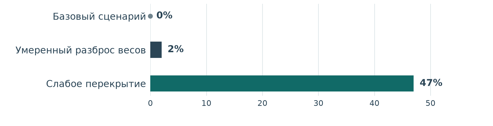

# OffPolicyLab: оценка альтернативных стратегий по историческим логам

## Цель

До A/B-теста оценить, как замена рекомендательной модели изменит долю принятых предложений или выручку на клиента. Источник для прогноза — история показов и откликов при действующей модели. По этой оценке можно отобрать версии для проверки на клиентском трафике.

## Что исследовали

Изучили методы off-policy evaluation (OPE). Одни прогнозируют отклик на предложение, другие перевзвешивают наблюдаемые отклики по вероятности показа, третьи сочетают эти подходы. Подбор методов обсудили с РЭШ и включили SNIPS, который нормирует веса на их сумму. На синтетических данных проверили сценарии с известными и восстановленными вероятностями показа, а также с редкими показами нужных предложений.

## Результаты

В открытой библиотеке OffPolicyLab реализовали пять методов оценки (DM, IPS, SNIPS, DR и SNDR), адаптеры данных, обучение модели отклика для DR и восстановление вероятностей показа. Библиотека позволяет сравнить несколько моделей-кандидатов с действующей на одних и тех же логах. Для каждой она показывает оценку эффекта, доверительный интервал и диагностику надёжности. При слабом перекрытии в симуляции 47% прогонов получили отметку «ненадёжно».

Разработали стратегию отбора версий. Сначала оценки OPE сверяют с результатами двух–трёх прошлых A/B-тестов той же системы. Если они согласуются, между более редкими A/B-тестами кандидатов сравнивают по накопленным логам. В очередном A/B-тесте проверяют отобранную версию и используют результат для повторной калибровки OPE.

### Когда истории показов недостаточно для оценки

Доля прогонов с отметкой «ненадёжно» для метрики принятия предложения. Три сценария симулятора OffPolicyLab с известными вероятностями показа. При слабом перекрытии действующая модель редко выбирает предложения новой модели.

## Итог

Стратегия может дать финансовый эффект по трём направлениям. Сравнение на уже собранных логах сокращает расходы на отдельный A/B-тест для каждого кандидата. Более короткий цикл отбора позволяет быстрее и чаще выпускать новые версии. Частый отбор среди нескольких кандидатов повышает шансы выбрать модель с лучшей целевой метрикой. Экономию, сокращение срока выхода модели и прирост качества после внедрения ещё предстоит измерить.

## Воспроизведение

[Ноутбук исследования](notebook.ipynb) · [Репозиторий OffPolicyLab](https://github.com/Yurashku/OffPolicyLab) · [Результаты симуляций](https://github.com/Yurashku/OffPolicyLab/blob/main/docs/validation.md) · [Туториал](https://github.com/Yurashku/OffPolicyLab/blob/main/examples/tutorial.ipynb)
