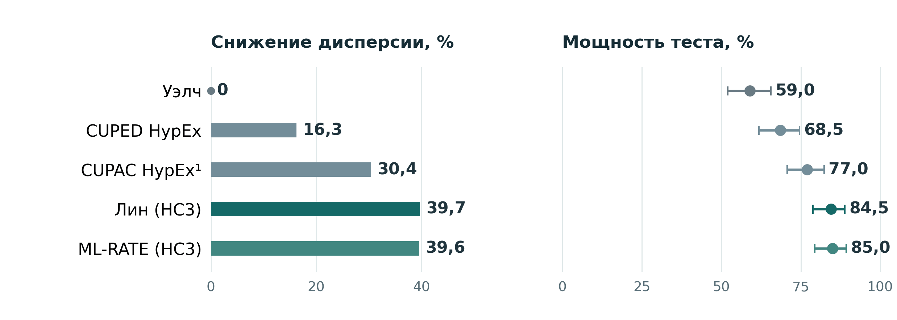

# VarWar: сравнение процедур экспериментов и выбор регрессионной корректировки по Лину для рассмотрения к внедрению в HypEx

## Цель

Выбрать метод анализа, который при том же числе участников чаще выявляет реальный положительный эффект пилота. Если задать минимальный практически значимый эффект и требуемую мощность, выигрыш в чувствительности можно учесть заранее и рассчитать меньшую выборку. Это позволяет снизить стоимость РКИ, когда затраты зависят от числа участников. Условия отбора — контроль ложных срабатываний на уровне 5% и покрытие 95%-х доверительных интервалов, близкое к номинальному.

## Что исследовали

На стенде VarWar применяли пять процедур к одним и тем же рандомизированным экспериментам с известным эффектом. Базовый метод — разность средних с тестом Уэлча. CUPED использует метрику до пилота, CUPAC — прогноз результата по историческим данным. В обоих случаях корректировка уменьшает часть разброса, объяснимую историей клиента.

Регрессия Лина учитывает исходные признаки и допускает разную связь признака с результатом в тесте и контроле. В ML-RATE аналогичную роль играет прогноз для каждого участника, полученный на данных других участников. Для Лина и ML-RATE сравнивали варианты с робастными стандартными ошибками HC3.

## Результаты

В сценарии с редкими экстремальными значениями мощность выросла с 59% у Уэлча до 84,5% у Лина и 85% у ML-RATE. Разница между двумя лидерами — одно обнаружение на 200 повторов. У пяти методов частота ложных срабатываний составила 3,0–4,5%, покрытие при эффекте 0,1 — 95,5–97,0%.

### Снижение дисперсии и мощность пяти процедур

Синтетика, полная рандомизация, 200 повторов на размер эффекта, на графике эффект 0,1. Отрезки — 95%-е интервалы Уилсона для мощности. ¹ CUPAC использует прогноз и корректировку из HypEx 1.0.6 с последующим тестом Уэлча.

## Итог

На 1 000 повторах в том же сценарии Лин снизил дисперсию на 39,4% и повысил мощность с 61,0% до 80,6%. Ложные срабатывания составили 4,8%, покрытие — 95,2%. Корректировку Лина взяли на рассмотрение для внедрения в HypEx. Она дала выигрыш, близкий к ML-RATE, без обучения отдельной прогнозной модели.

## Воспроизведение

[Ноутбук исследования](notebook.ipynb) · [Репозиторий VarWar](https://github.com/Yurashku/VarWar)
