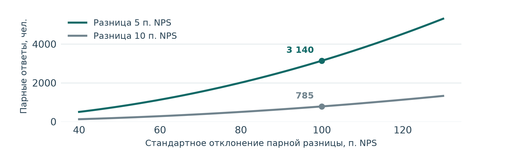

# Методология сравнения конкурентного NPS для отчётности высшему руководству

## Цель

По результатам анкетирования определить, какие различия в NPS банков можно уверенно показать руководству. Для этого важно знать, кто оценивал каждый банк, какую разницу способен обнаружить опрос и на какую аудиторию распространяется вывод.

## Что исследовали

Сопоставили три группы: респондентов, оценивших конкретный банк, тех, кто оценил оба банка в паре, и всех участников опроса. Для парных ответов рассчитали, сколько респондентов нужно, чтобы обнаружить разницу в 5 или 10 пунктов NPS. Отдельно проверяли, отличаются ли участники пересечения по составу и оценкам от остальных респондентов каждого банка.

## Результаты

Собрали пять проверок в одном ноутбуке: доверительные интервалы NPS, баланс аудиторий, мощность парного сравнения, репрезентативность пересечения и пересчёт к единому составу опрошенных. Для пересчёта реализовали взвешивание по вероятности принадлежности к аудитории (IPW) и его вариант с моделью отклика (AIPW).

### Сколько парных ответов нужно для сравнения NPS

Расчёт для парного сравнения при мощности 80% и двустороннем уровне значимости 5%. Например, при стандартном отклонении парной разницы 100 пунктов для обнаружения 10 пунктов NPS нужно 785 ответов, для 5 пунктов — 3 140. Это ориентир для планирования опроса.

## Итог

Методику взяли в работу для отчётности высшему руководству. Рядом с разницей NPS указывают, кто оценивал оба банка и какую разницу позволяет обнаружить эта выборка. При пересчёте к общей аудитории дополнительно проверяют, достаточно ли наблюдений после взвешивания.

## Воспроизведение

[Ноутбук исследования](notebook.ipynb)
